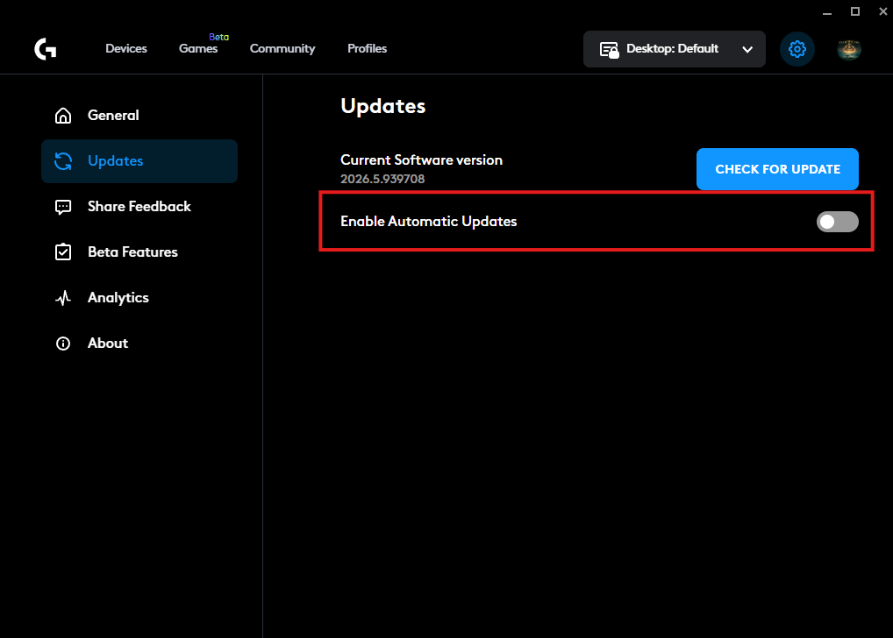

  <h1 align="center">🎧 Logitech G HUB Dolby Unlock</h1>
  <strong>🔊 Dolby device definitions for supported Logitech headsets</strong> 
  Modified Logitech headset driver · G HUB integration

  <a href="https://github.com/RESTLESS14/Logitech-Headsets-Modded-Driver-Unlock-Dolby-in-G-HUB/releases/tag/v1.1.0">🚀 Latest update · v1.1.0</a>
  &nbsp;•&nbsp;
  <a href="https://www.techpowerup.com/forums/threads/logitech-headsets-modded-driver-%E2%80%94-unlock-dolby-in-g-hub.352645/">💬 TechPowerUp thread</a>

## 🗂️ Contents

- [✨ Features](#features)
- [🧭 Setup options](#setup-options)
- [🛠️ Full setup stages](#full-setup-stages)
- [🧩 Cache patching](#cache-patching)
- [🔄 G HUB updates](#g-hub-updates)
- [✅ Compatibility](#compatibility)

## ✨ Features

| Feature | Description |
|---|---|
| 🔊 Dolby device definitions | Adds Dolby controls in G HUB for supported Logitech headsets. |
| 🧩 Active cache patch | Updates the active G HUB cache so it loads the modified device definitions. |
| 🎙️ Blue VO!CE 2.0 Effect | Includes files for devices that support this feature. |
| 🛠️ Setup modes | Provides Full setup and Dolby unlock only options. |

  <table>
    <tr>
      <td align="center" width="400">
         
        Dolby device controls in G HUB
      </td>
      <td align="center" width="400">
         
        Blue VO!CE 2.0 Effect
      </td>
    </tr>
  </table>

## 🧭 Setup options

| Menu option | Driver cleanup and install | Dolby depot files | Active cache patch | Reset `settings.db` |
|---|:---:|:---:|:---:|:---:|
| **[1] Full setup** | Yes | Yes | Yes | Yes, after backup |
| **[2] Dolby unlock only** | No | Yes | Yes | No |

## 🛠️ Full setup stages

| Stage | Operation | Result |
|---|---|---|
| **1 · 🔇 Audio and G HUB** | Stops Windows Audio and G HUB. | Audio services and G HUB are paused for setup. |
| **2 · 🧹 Driver cleanup** | Removes selected old Logitech audio-driver packages and ghost devices. | Prepares Windows for the supplied driver. |
| **3 · 💿 Driver installation** | Stages the supplied driver and applies it to supported connected hardware with DevCon. | The selected Logitech audio driver is installed. |
| **4 · 🎧 Dolby files** | Backs up and updates the device definitions in the installed G HUB depot. | G HUB receives the modified Dolby definitions. |
| **5 · 🧩 Cache patch** | Backs up and patches the active G HUB cache package. | G HUB can load the updated device definitions. |
| **6 · ⚙️ Settings reset** | Backs up `%LocalAppData%\LGHUB\settings.db`, then removes it. | G HUB rebuilds its local settings. |
| **7 · 🔊 Restart** | Starts Windows Audio and G HUB again. | Audio and G HUB services resume. |

**Dolby unlock only** applies the Dolby depot files and cache patch. It skips driver cleanup and installation, and leaves `settings.db` unchanged.

## 🧩 Cache patching

`Patch-GHubCache.ps1` locates the active G HUB cache file in `C:\ProgramData\LGHUB\cache`. It patches only these two device-definition entries inside that cache file:

- `devices_0001.json`
- `devices_0002.json`

The patcher backs up the cache file, writes the Dolby-modified definitions, verifies the result, and keeps the cache filename unchanged. If the definitions are already present, it leaves the cache as it is.

## 🔄 G HUB updates

Keep automatic updates turned off while using the modification. G HUB updates may replace the modified depot files or cache package.

   
  G HUB Settings → Updates → Enable Automatic Updates

## ✅ Compatibility

| Category | Supported devices or versions |
|---|---|
| **Headsets** | Logitech G430, G431, G432, G433, G533, G633, G635, G733, G933, G935, PRO X, PRO X Wireless |
| **Windows** | Windows 10 / Windows 11 |
| **G HUB** | The setup detects the installed depot. Compatibility may vary by G HUB version and headset model. |

---

Community driver modification. Not affiliated with or endorsed by Logitech.