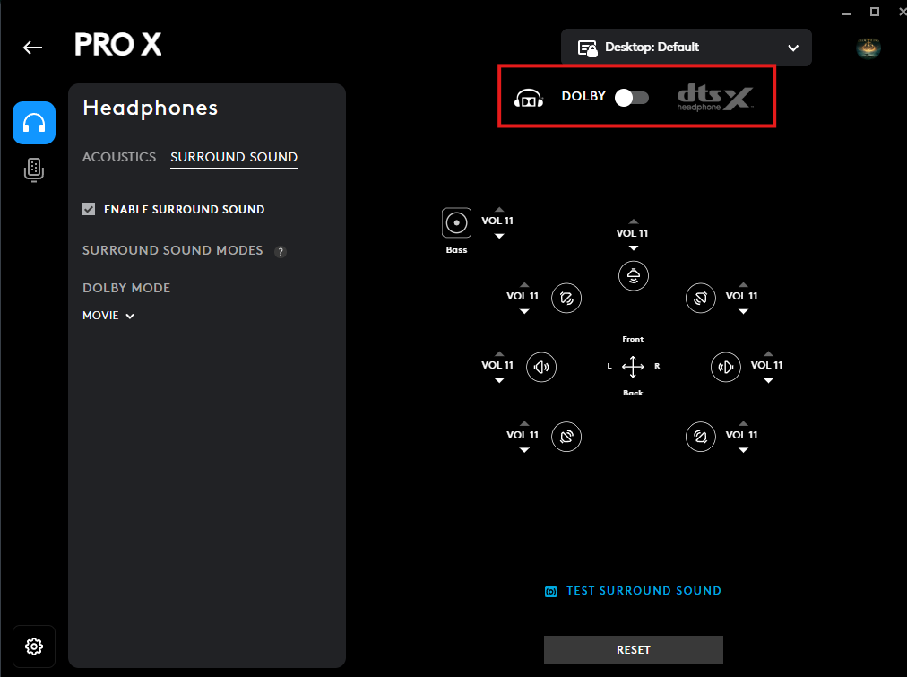

<p align="center">
  <h1 align="center">🎧 Logitech Headsets Modded Driver — Unlock Dolby in G HUB</h1>
</p>

<p align="center">
A community modification that enables Dolby device definitions in Logitech G HUB for supported Logitech headsets.
</p>

<p align="center">
Based on Logitech headset audio-driver files. This project is not affiliated with or endorsed by Logitech.
</p>

[Original TechPowerUp thread](https://www.techpowerup.com/forums/threads/logitech-headsets-modded-driver-%E2%80%94-unlock-dolby-in-g-hub.352645/)

## Features

- Dolby device definitions for G HUB.
- Logitech audio-driver cleanup and installation through the setup package.
- Patches the active G HUB core cache without changing its expected filename.
- Updated Blue VO!CE files for devices that support Blue VO!CE 2.0.

<p align="center">
  <table>
    <tr>
      <td align="center" width="400">
        <br>
        <sub>🔊 Dolby</sub>
      </td>
      <td align="center" width="400">
        <br>
        <sub>🎙️ Blue VO!CE 2.0 Effect</sub>
      </td>
    </tr>
  </table>
</p>

## Installation

> **Installer package:** `SETUP.bat` and its complete `Payload` folder are distributed separately from this source repository. Keep them together after extraction.

Run `SETUP.bat` as administrator and choose an option:

### 1. Full setup

1. Adds the `Restless14` certificate to the Windows **Root** and **TrustedPublisher** stores.
2. Stops Windows Audio and G HUB, then removes the selected old Logitech audio-driver packages and ghost devices.
3. Stages the supplied Logitech audio driver and applies it to supported connected devices with DevCon.
4. Backs up and updates the Dolby device JSON files in the installed G HUB depots, then patches the active core cache.
5. Backs up `%LocalAppData%\LGHUB\settings.db` and deletes it to reset G HUB settings.
6. Restarts Windows Audio and G HUB.

### 2. Dolby unlock only

Stops G HUB, backs up and reapplies the Dolby depot files, patches the active core cache, then launches G HUB and verifies the depot files remain in place. It does not reinstall the driver or reset `settings.db`.

## Cache patch

The patcher reads `%ProgramData%\LGHUB\current.json` to identify the active core-cache filename. It confirms that this active hash-named package is the largest cache package, then replaces only these entries:

- `data/devices/devices_0001.json`
- `data/devices/devices_0002.json`

The patcher verifies the updated entries and backs up the original cache before replacing its contents. It preserves the filename G HUB expects. **Do not rename the cache file manually.** If the cache already contains the Dolby definitions, it is left unchanged.

## Backups

Backups are stored in a timestamped folder under:

```text
%ProgramData%\Logitech-Dolby-Unlock\Backups\<timestamp>
```

The setup saves the original depot JSON files and, when it patches the cache, the original core-cache file. Full setup also backs up `settings.db` before deleting it. Static files under `Payload\DOLBY UNLOCKED FILES\BACKUP DEVICES` are part of the package; runtime backups are captured from the computer running setup.

## Before installing

- Back up your G HUB profiles. Resetting `settings.db` may reset local G HUB settings and profile assignments.
- The full setup trusts a third-party certificate named `Restless14` in Windows certificate stores. Run it only if you trust this modification.
- Keep G HUB Automatic Updates disabled while using the modification. An update can replace the modified depot or cache content.

In G HUB, open **Settings → Updates** and turn off **Enable Automatic Updates**.

### Back up and restore profiles

Before full setup, open **G HUB → Manage Profiles**, select a profile, click the three-dot menu, and choose **Share** to save it to your Logitech account or **Backup** to save it locally.

After resetting G HUB, you may need to add or scan for your games again. If a restored profile appears under **Desktop**, use its three-dot menu to copy it to the correct game.

## Compatibility

| Category | Details |
|---|---|
| Headsets | Logitech G430, G431, G432, G433, G533, G633, G635, G733, G933, G935, PRO X, PRO X Wireless |
| OS | Windows 10 / Windows 11 |
| G HUB | The setup detects the installed depot; compatibility can vary by G HUB version and headset model. |

Thanks to [Tunnah](https://www.techpowerup.com/forums/members/tunnah.100852/) for feedback on the original TechPowerUp thread.